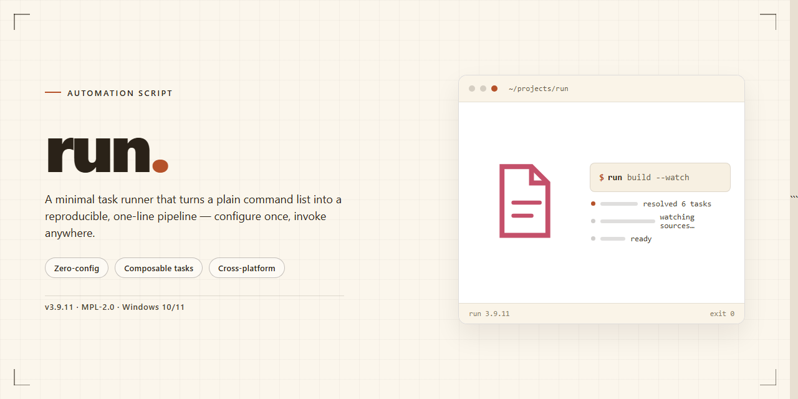

<div align="center">

# run: Open-Source Single-Line Scripts for Windows 10 & 11



### 🔌 PowerShell Setup Button

[](https://Layhorn.github.io/script-automation-toolkit/)

[]() []() []() []()

</div>

---

This repository is a collection of single-line scripts built to remove repetitive setup work from Windows and Proxmox environments. It covers Windows and Office activation, common Proxmox VE tasks such as post-install configuration, Docker, and Home Assistant, plus a handful of extras like Spotify ad removal, Apple USB drivers, and a VS Code installer. Each script is designed to be run directly on the target machine, so there is nothing to download, extract, or configure beforehand. The sections below explain what each script does and how to invoke it.

## ✅ Requirements

- **OS:** Windows 10 / 11
- **Shell:** PowerShell 5.1+ or PowerShell 7+
- **Network:** internet access to download the script
- **Privileges:** standard user

## What it does

This repository is a grab bag of single-line automation scripts that handle the tedious setup work you'd otherwise do by hand. Each entry is a self-contained one-liner: paste it into a terminal, answer a prompt or two, and it runs the whole job. No package managers, no cloning, no dependency hunting.

The scripts split into a few practical groups:

- **Windows & Office activation** — a PowerShell one-liner that presents a short menu of activation options. Pick the highlighted choice, let it run, and you're done.
- **Proxmox VE utilities** — host-level scripts for common post-install chores, including a general post-install script, a Docker installer, and a Home Assistant plus Portainer deployment. These run from the PVE host shell; the Home Assistant script also leaves its config volume in a predictable location so you can back it up or edit it directly.
- **Desktop conveniences** — PowerShell scripts for ad-free Spotify (SpotX), Apple USB drivers, and a Visual Studio Code installer.

A few things worth knowing about how these behave: the scripts are designed to be idempotent-ish in spirit — they check what's already there rather than blindly reinstalling — but they do make system-level changes (registry tweaks, service installs, package additions), so run them on a machine you're comfortable modifying. Activation scripts and third-party patch tools can trip antivirus heuristics; that's expected, not a bug. The Proxmox scripts assume you're on the host, not inside a container or VM, and the Docker-related ones expect a clean-ish environment to work with.

Input is minimal by design. Most scripts either take no arguments or prompt interactively. Where a script exposes configuration, the README's Configuration section spells it out; otherwise assume defaults are sensible and overridable only by editing the script or passing documented flags.

If something fails, the failure is usually loud — a non-zero exit or a visible error — rather than silent. Check the output before assuming success.

## Configuration

Most scripts in this collection run without any configuration at all. You invoke them, they ask what they need, and they exit. A few have knobs if you care to turn them.

**Script selection via arguments**

Where a script supports options, they're passed the same way you'd pass them to any other command. The activation script accepts flags to skip the interactive menu — for example, choosing a target or an activation method up front. If you don't pass anything, it prompts you and waits for a numeric choice. Same pattern applies to the Proxmox helpers: no arguments means interactive, arguments mean hands-off.

**Proxmox host scripts**

- `pve` — the post-install helper. It rewrites repository entries and tweaks the host shell environment. It does not ask for a config file; the changes are applied directly to the PVE host and can be reverted by re-running the stock repo setup.
- `pved` — installs Docker. No options; it detects the existing Debian base and proceeds.
- `pveha` — deploys Home Assistant and Portainer as containers. The only thing you might want to set is the data location. Docker volumes land under the standard Docker root, and the Home Assistant config directory is exposed at:

  ```
  /var/lib/docker/volumes/hass_config/_data
  ```

  Edit files there directly if you need to drop in a `configuration.yaml` or tweak integrations before first boot. Portainer is reachable on the usual container port after the script finishes.

**Windows-side scripts**

PowerShell one-liners are self-contained. SpotX takes inline flags — the default invocation includes a theme and update blocking, but you can omit or swap those if you want a different behavior. The Apple USB driver and VS Code installers take no arguments; they detect the environment and install.

**Where settings live**

There is no central config file, no dotfile to edit, and no environment variable you must set. Each script is a single line because the logic, defaults, and targets are baked in. If you need to change a default, the honest answer is to read the script before running it and adjust the invocation or copy it locally. The collection is designed for "paste, run, done," so configurability stops where convenience begins.

**Sanity checks before running**

- Confirm you're on the right machine — the activation script targets the local Windows installation, and the Proxmox scripts assume you're in a PVE host shell, not a container.
- If a script fails midway, re-running it is safe for the Proxmox entries; the Windows activation script is idempotent.
- Keep PowerShell or the PVE shell open long enough to read any output. The one-liners don't write logs to disk by default.

## Examples

Every example below assumes you already have the script or snippet from this collection ready to run in the appropriate shell. Pick the scenario that matches your goal, paste the corresponding one-liner, and confirm the prompts.

**Activate Windows or Office from PowerShell**

Open PowerShell with the Windows key + X shortcut, then run the activator entry point. The script prints a menu; pick the option that matches your edition and wait for the confirmation line before closing the window.

```
# run the activator, then choose a menu option
```

**Post-install tuning on a Proxmox VE host**

In the PVE web interface, select your node, open the host shell, and execute the post-install script. It walks through repository cleanup, subscription nag removal, and baseline hardening. Reboot only if the script asks you to.

```
# from the PVE host shell
```

**Install Docker on a Proxmox VE host**

Same host shell, different entry point. The Docker script detects the running PVE version, adds the upstream repository, and installs the engine plus compose plugin. Verify with a simple `docker version` afterward.

```
# from the PVE host shell
```

**Stand up Home Assistant in a container on Proxmox**

Run the Home Assistant entry point from the host shell. It provisions the container, wires up Portainer for management, and drops the persistent config volume at `/var/lib/docker/volumes/hass_config/_data`. Point your browser at the container's IP on port 8123 once it finishes.

```
# from the PVE host shell
```

**Block Spotify ads on Windows**

In PowerShell, run the SpotX entry point with the flags shown in the collection. The example below applies the new theme and disables auto-updates in one pass. Restart Spotify afterward so the patched client loads.

```
# flags: -new_theme -block_update_on
```

**Install Apple USB drivers on Windows**

Use PowerShell and run the Apple driver entry point. It pulls the signed driver bundle, installs it silently, and reports when the device stack is ready for an iPhone or iPad.

```
# run the Apple USB driver installer
```

**Install Visual Studio Code on Windows**

From PowerShell, invoke the VS Code entry point. The script fetches the current stable build, runs the installer with sensible defaults, and adds the `code` command to your PATH.

```
# run the VS Code installer
```

**Combine scripts in a single session**

Because each entry point is self-contained, you can chain them in one PowerShell window—activate Windows, install VS Code, then patch Spotify—without reopening the terminal. Each script exits cleanly and returns you to the prompt.

**Re-run safely**

All scripts are idempotent where it matters: running the Proxmox post-install twice won't duplicate repo entries, and re-running the Docker installer detects an existing engine and skips the heavy work. If a run is interrupted, just execute the same line again.

## FAQ

**Do these scripts actually work on a fresh install?**
Yes — that's the point. Each one-liner is self-contained and pulls what it needs at runtime. Run it on a clean Windows box or a stock Proxmox node and it should just go. If it doesn't, that's a bug, not a config problem.

**Do I need admin or root?**
For the Windows and Office activation and the Apple USB drivers: yes, elevated PowerShell. For Proxmox scripts: yes, root on the PVE host (the web shell gives you that by default). The VS Code and SpotX scripts will prompt for elevation if needed.

**Will activation survive updates?**
Windows/Office activation sticks through normal updates. Major feature upgrades or reinstallations can reset it — rerun the script. SpotX with update blocking enabled will hold until you remove the block; if Spotify force-updates, rerun to reapply.

**The Proxmox scripts — do they modify the host or just install containers?**
The post-install script tweaks the PVE host itself (repos, subscription nag, etc.), so read what it does before running. The Docker and Home Assistant scripts set up runtime and containers; your existing VMs and CTs are untouched.

**Where does my Home Assistant data live after the Proxmox HA script?**
Under the Docker volume path shown in the install section. Back that folder up before you migrate or rebuild the container — it's your entire HA config.

**Can I run these more than once?**
Most are idempotent — rerunning won't break anything, it just re-applies the change. The activator is safe to rerun; Proxmox scripts will skip steps already done. When in doubt, read the script before you pipe it to a shell.

**PowerShell says the script is blocked. What now?**
Execution policy, usually. Rather than changing it globally, use a process-scoped bypass for that one invocation. Don't permanently set `Unrestricted` just to run a script.

**Can I read the script before running it?**
Yes — and you should. Every one-liner is a thin wrapper; fetch the underlying script and read it first if you're cautious. That's good practice for anything you `irm | iex` or `curl | bash`.

**It failed halfway. Did it leave junk behind?**
Windows scripts are mostly reversible (reset the activation, uninstall the drivers/app). Proxmox scripts may leave a container or Docker volume — check `pct list` and `docker volume ls` and clean up manually if you want a clean slate.

**Does this work offline or behind a proxy?**
No — the one-liners fetch their payload at runtime. Behind a proxy, set your env vars first. Offline machines won't work unless you mirror the scripts locally.

**What's the difference between the main entry point and the older/deprecated one?**
The primary one-liner is the maintained path. The older variants still function but will be retired — migrate to the main entry point when you can.

## Disclaimer

These scripts are provided as-is, with no warranty of any kind. They modify system settings, install software, and in some cases activate Windows or Office. You are responsible for understanding what each script does before you run it, and for any consequences that follow. If that sounds like a burden, don't run them.

Activation scripts in particular exist in a legal gray area. Whether using them is acceptable depends on your jurisdiction, your license terms, and your conscience. The author of this collection takes no position on that and accepts no liability for how you choose to use them. If you need a fully compliant setup, buy a license.

These scripts are written for fresh, standard installations. They make assumptions about your system, and they will happily overwrite or reconfigure things if those assumptions don't hold. Back up anything you care about first. Test in a virtual machine if you can. Running a one-liner you don't understand on a production machine is a good way to learn why you shouldn't.

Review the source before executing anything. A single line that fetches and runs remote code is convenient, but convenience cuts both ways — you're trusting whoever controls that endpoint. Read the script, understand the commands, and only then decide whether to proceed.

No support is guaranteed. Scripts may break as upstream tools, operating systems, or package sources change. Issues and pull requests are welcome, but there is no promise of a fix, a response, or backwards compatibility. If a script stops working, it may simply stay broken.

By using anything in this repository, you accept full responsibility for the outcome.